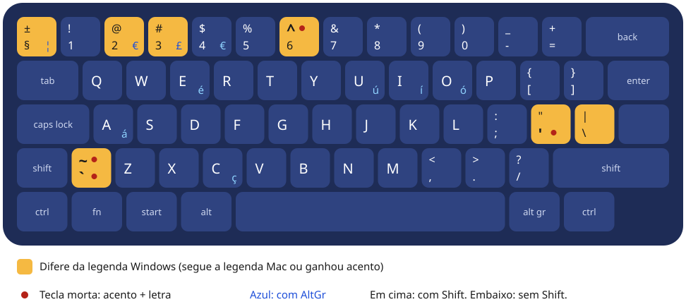

# UKPTINT: acentos do português no Logitech K380 britânico (Windows)

Layout de teclado para Windows 10 e 11 feito para quem tem o **Logitech K380 com layout britânico (UK, ISO)** e escreve em português do Brasil.

O K380 UK traz duas legendas em cada tecla: a do Windows à esquerda e a do Mac à direita. No Windows, nenhum layout pronto resolve bem esse teclado:

- **Reino Unido:** segue a legenda Windows, mas não tem acentos práticos. ã, õ, â, ê e ô ficam de fora.
- **Reino Unido Estendido:** os acentos ficam escondidos no AltGr.
- **ABNT2 ou US-Internacional:** quase nenhum símbolo bate com o que está impresso nas teclas.

O UKPTINT segue a **legenda Mac** impressa no K380 (@ no Shift+2, " no Shift+apóstrofo, \ ao lado do Enter, crase e til na tecla ao lado do Shift esquerdo). Também acrescenta teclas mortas para todos os acentos do português: primeiro o acento, depois a letra. Quem alterna entre Mac e Windows com o mesmo K380 passa a digitar igual nos dois.



## Acentos

| Acento | Como digitar | Resultado |
|---|---|---|
| Agudo | `'` + vogal | á é í ó ú Á É Í Ó Ú |
| Cedilha | `'` + c | ç Ç |
| Crase | tecla ao lado do Shift esquerdo + vogal | à À (e è ì ò ù) |
| Til | Shift + tecla ao lado do Shift esquerdo + letra | ã õ ñ Ã Õ Ñ |
| Circunflexo | Shift + 6 + vogal | â ê î ô û Â Ê Î Ô Û |
| Atalhos diretos | AltGr + A, E, I, O, U, C | á é í ó ú ç (com Shift: maiúsculas) |

O comportamento é igual ao do Mac. Se o caractere seguinte não forma acento, a tecla morta sai junto com ele:

- `'` + `s` = `'s`
- `` ` `` + `x` = `` `x ``
- três crases seguidas saem ```` ``` ````, para blocos de código em Markdown
- acento + espaço = o sinal sozinho (`'`, `` ` ``, `~`, `^`)

## O que muda em relação ao layout "Reino Unido" do Windows

| Tecla física | Reino Unido (Windows) | UKPTINT |
|---|---|---|
| Acima do Tab | `` ` `` ¬ | § ± (AltGr: ¦, Shift+AltGr: ¬) |
| 2 | 2 " | 2 @ (AltGr: €) |
| 3 | 3 £ | 3 # (AltGr: £) |
| 6 | 6 ^ | 6 e ^ como tecla morta |
| 2a à direita do L | ' @ | `'` como tecla morta (agudo e cedilha), Shift: " |
| 3a à direita do L (junto ao Enter) | # ~ | \ \| |
| Ao lado do Shift esquerdo | \ \| | `` ` `` e `~` como teclas mortas |
| C | sem AltGr | AltGr: ç Ç |

As demais teclas e todos os atalhos com Ctrl (Ctrl+C, Ctrl+V, Ctrl+Z e similares) continuam iguais ao layout Reino Unido.

## Instalação

1. Baixe o [`UKPTINT-instalador.zip`](https://github.com/rodrigocpaiva/k380-uk-ptbr/releases/latest/download/UKPTINT-instalador.zip) (também na página de [releases](https://github.com/rodrigocpaiva/k380-uk-ptbr/releases)) e extraia numa pasta.
2. Execute o `setup.exe`. O instalador não tem assinatura digital, então o Windows pode exibir um aviso do SmartScreen. Para continuar, clique em "Mais informações" e depois em "Executar assim mesmo".
3. Saia da sua conta do Windows e entre de novo, ou reinicie o computador.
4. Abra **Configurações > Hora e idioma > Idioma e região > Português (Brasil) > Opções de idioma** e adicione o teclado **UK Intl PT-BR (acentos)**.
5. Se o **Português (Brasil) - ABNT2** aparecer na mesma lista, remova-o. Assim o Win+Espaço não alterna entre os dois.

**Para desinstalar:** remova o teclado em Configurações e depois desinstale "UK Intl PT-BR (acentos)" em **Configurações > Aplicativos**.

## Cuidados no dia a dia

- Em código, um apóstrofo seguido de vogal ou de c vira acento: `'a'` sai `á'`. Nesses casos, digite `'` + espaço e depois a letra.
- Ctrl+Alt+C, Ctrl+Alt+E e combinações parecidas passam a gerar ç, é etc. Algum aplicativo que use esses atalhos deixa de recebê-los.

## Arquivos

| Caminho | Conteúdo |
|---|---|
| [`UKPTINT-instalador.zip`](UKPTINT-instalador.zip) | Instalador pronto (setup.exe, MSI e DLLs para 32 e 64 bits) |
| `setup.exe`, `*.msi`, `amd64/`, `i386/`, `ia64/`, `wow64/` | Os mesmos arquivos do zip, já extraídos |
| [`fonte/UKPTINT.klc`](fonte/UKPTINT.klc) | Fonte do layout para o Microsoft Keyboard Layout Creator 1.4 |
| [`fonte/gen_klc.ps1`](fonte/gen_klc.ps1) | Gera o `.klc`. As constantes (nome, idioma) ficam no topo |
| [`fonte/validate_klc.py`](fonte/validate_klc.py) | Confere a estrutura do `.klc` e simula as teclas mortas (requer Python 3) |

## Como personalizar

1. Instale o Microsoft Keyboard Layout Creator 1.4, disponível no Centro de Download da Microsoft. No Windows 11 ele precisa do .NET Framework 3.5, que se ativa em "Ativar ou desativar recursos do Windows".
2. Edite as tabelas em `fonte/gen_klc.ps1` e gere o arquivo:
   ```powershell
   powershell -ExecutionPolicy Bypass -File .\fonte\gen_klc.ps1
   ```
3. Se tiver Python, confira o resultado:
   ```powershell
   python .\fonte\validate_klc.py
   ```
4. No MSKLC, abra o arquivo em **File > Load Source File**, valide em **Project > Validate Layout** e gere o instalador em **Project > Build DLL and Setup Package**.

O MSKLC mostra três avisos esperados, que não afetam o funcionamento:
- o € aparece em duas teclas (AltGr+2 e AltGr+4);
- a crase e o til só existem na tecla ISO, porque teclados americanos não têm essa tecla.

Para registrar o layout sob o idioma Inglês (Reino Unido) em vez de Português (Brasil), use as constantes comentadas no topo do `gen_klc.ps1`.

## Referências

- Layout base: [United Kingdom Extended (kbdukx) em kbdlayout.info](https://kbdlayout.info/kbdukx)

Projeto pessoal, sem vínculo com a Logitech ou a Microsoft. Logitech e K380 são marcas da Logitech.
